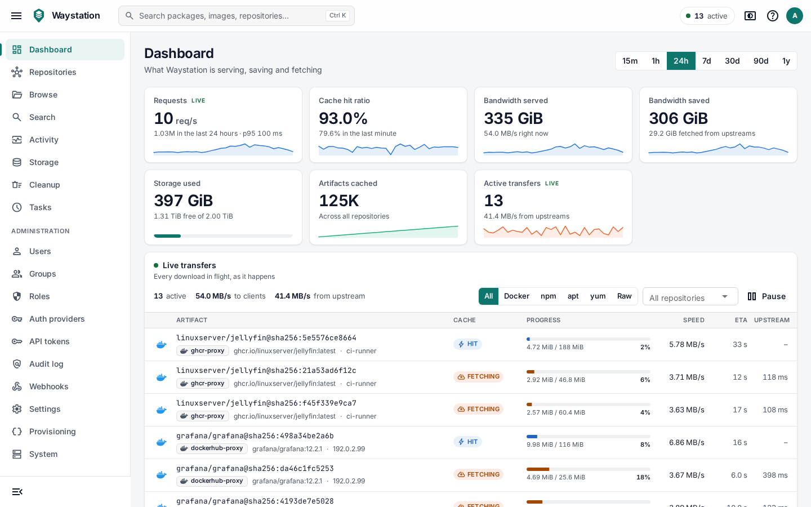
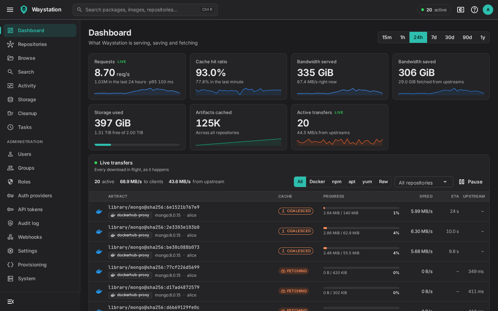
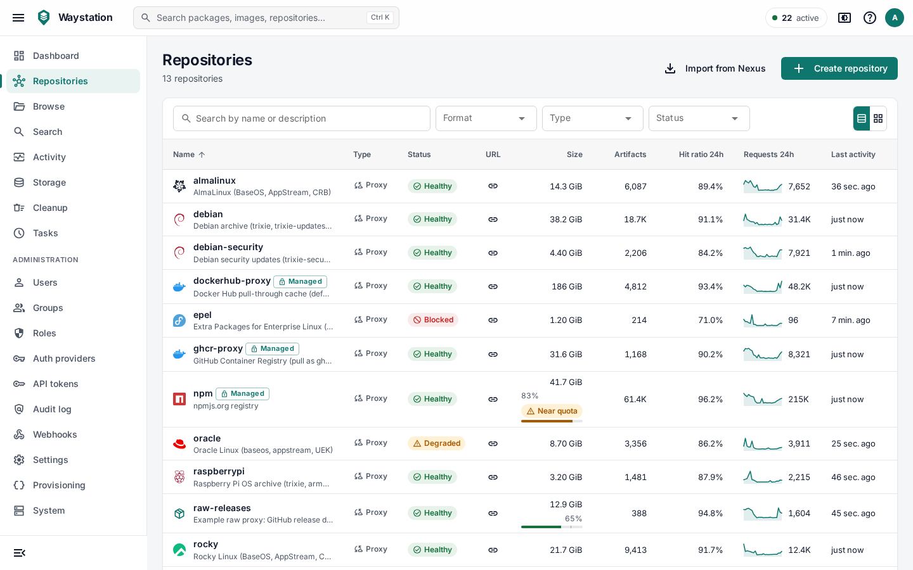
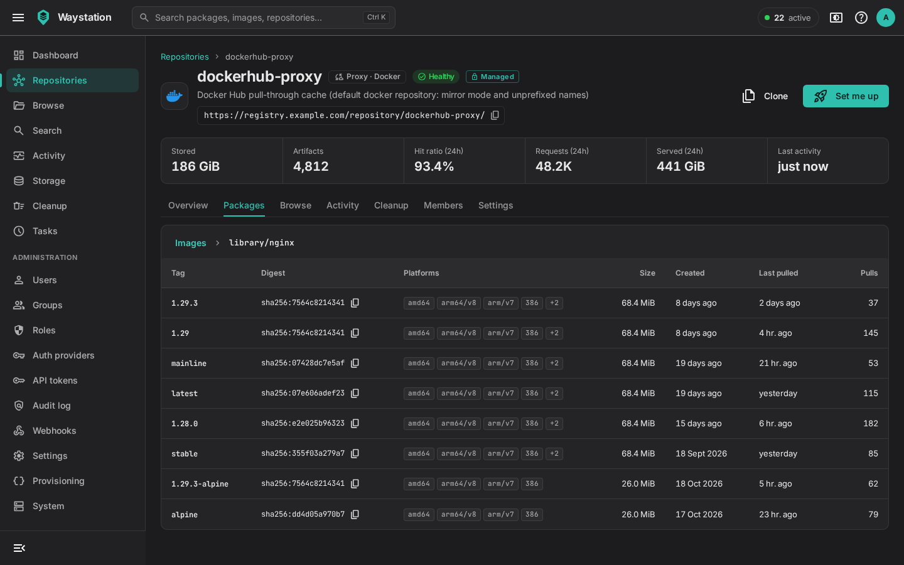
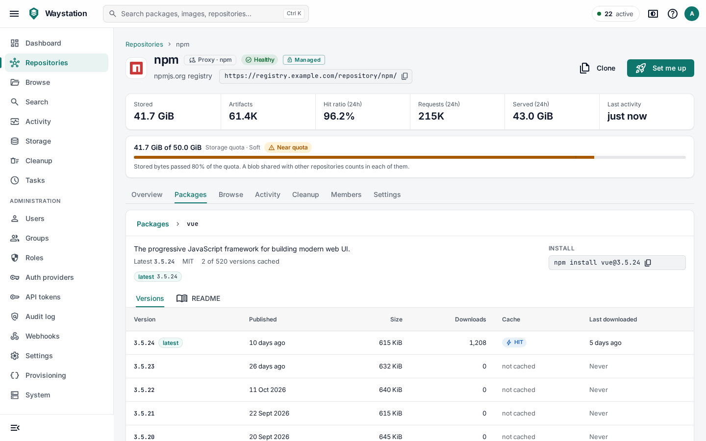
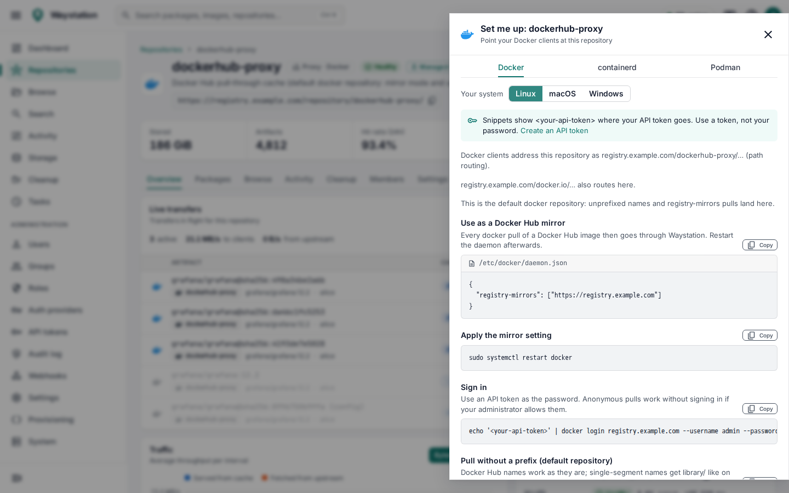
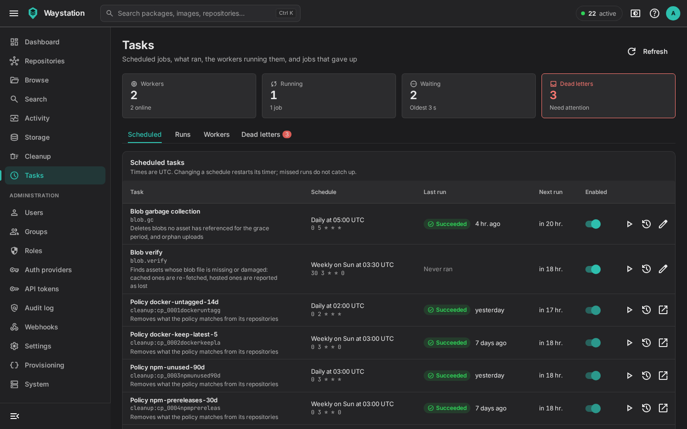
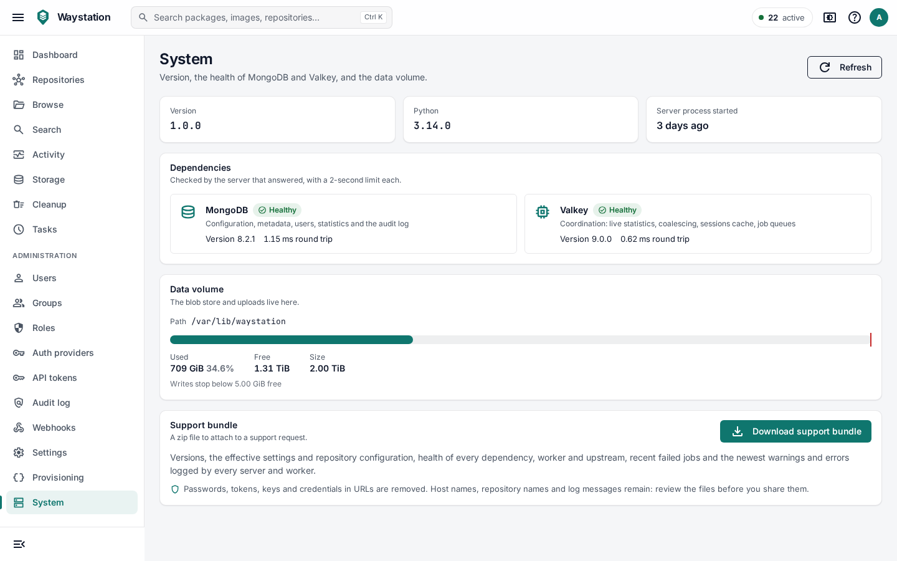

# Waystation

**Every package, one stop.** Waystation is a free, open-source, self-hosted **artifact repository** and
**package registry**: one fast pull-through cache for Docker Hub, GHCR, npm, PyPI, Maven Central, Debian and Ubuntu
apt, RPM yum/dnf, Go modules, Helm charts, Terraform, Ansible Galaxy, NuGet, Composer, Cargo, RubyGems, Conda,
Alpine, Swift and the Hugging Face Hub, plus a private registry for the images and packages you build. It is a
modern, lightweight **alternative to Sonatype Nexus Repository and JFrog Artifactory**, with no component caps, no
request limits, no licence keys and no telemetry.

Run it on a home lab server, a NAS, a small office box or a CI fleet, point your clients at it, and every
`docker pull`, `npm install`, `pip install`, `apt upgrade` and `dnf update` after the first one comes straight from
your own disk, at LAN speed, even when Docker Hub rate-limits you or the upstream is down.



## Highlights

- **One registry for everything.** Nineteen package formats behind one URL and one sign-in: proxy (cache),
  hosted (private) and group (merged) repositories, with a "Set me up" panel that shows the exact client
  configuration for every repository, operating system and client.
- **Save bandwidth, beat rate limits.** Docker Hub is cached once for the whole network, and daemon
  `registry-mirrors` mode works out of the box. Files are content-addressed and stored once, however many
  repositories hold them.
- **Fast by design.** An async Python core with nginx serving cached files straight from disk (`X-Accel-Redirect`).
  Request coalescing turns a hundred clients asking for the same layer into one upstream fetch, and a download keeps
  caching when the client that started it gives up. Performance budgets are enforced in CI.
- **Safe with untrusted content.** Every digest and checksum is verified, every size is bounded, every path is
  normalised, archives are read with bounded readers, redirects to private addresses are refused (SSRF guard), and
  signed apt, yum and Alpine metadata passes through byte for byte. Reviewed against OWASP ASVS Level 2.
- **See it happen.** A live dashboard with every transfer in flight, cache hit ratio, bandwidth saved, upstream
  health and per-repository and per-package statistics; an activity feed and a full audit log.
- **Sign in your way.** Local accounts with TOTP two-factor, LDAP and Active Directory, OpenID Connect single sign-on
  (Keycloak, authentik, Entra ID and others), group-to-role mapping, role-based access control down to the
  repository, API tokens and service accounts for CI.
- **Built to operate.** Cleanup policies and garbage collection, per-repository quotas and a low-disk guard, prefetch
  jobs that keep popular metadata and images warm, signed webhooks, Prometheus metrics with a Grafana dashboard and
  a Zabbix template, backup and restore tooling with blob verification, secret-key rotation, a redacted support
  bundle, and declarative provisioning from a YAML file.
- **Leaving Nexus?** The built-in importer reads your Nexus 3 repositories (names, upstreams, Docker connectors and
  aliases), and a side-by-side script compares the two before you switch. Repository names and paths match Nexus, and
  Docker dedicated-port connectors are supported, so your clients don't change.

## Screenshots

| | |
|---|---|
|  |  |
| Live dashboard, dark theme | Repositories at a glance |
|  |  |
| Docker tags, digests and platforms | npm package versions and cache state |
|  |  |
| "Set me up" for every client | Scheduled tasks and workers |



## Formats

| Format | Proxy (cache) | Hosted (private) | Group | Clients |
|---|---|---|---|---|
| Docker / OCI (Docker Hub, GHCR, Quay, any registry; Helm OCI and other OCI artifacts) | yes | yes | yes | docker, podman, containerd, skopeo, crane, helm |
| npm | yes | yes | yes | npm, yarn, pnpm, bun |
| PyPI | yes | yes | yes | pip, uv, twine, poetry |
| Maven / Gradle | yes | yes (releases and snapshots) | yes | mvn, gradle |
| apt (Debian, Ubuntu, Raspberry Pi OS) | yes | yes, signed | | apt |
| yum / dnf (Rocky, Alma, RHEL, Oracle, Fedora, EPEL) | yes | yes, signed | | dnf, yum |
| Go modules (with checksum database proxy) | yes | | yes | go |
| Helm charts (classic `index.yaml`) | yes | yes | yes | helm |
| Terraform / OpenTofu providers and modules | yes (network mirror) | yes | | terraform, tofu |
| Ansible Galaxy collections | yes | yes | yes | ansible-galaxy |
| NuGet v3 | yes | yes | yes | dotnet, nuget |
| Composer (PHP) | yes | yes | yes | composer |
| Cargo (sparse registries) | yes | yes | yes | cargo |
| RubyGems | yes | yes | yes | gem, bundler |
| Conda channels | yes | yes | | conda, mamba, micromamba, pixi |
| Alpine apk | yes | yes | | apk |
| Swift Package Registry | yes (from Git hosts) | yes | | swift |
| Hugging Face Hub (models and datasets) | yes | | | huggingface_hub, transformers, `hf` |
| Raw files (GitHub releases, any HTTP) | yes | yes | yes | curl, wget |

Client setup for every format is in [`Documents/Operations/clients/`](Documents/Operations/clients/), and each
repository's "Set me up" panel shows the same configuration with your URL filled in.

## Quick start

You need Docker Engine 24+ with Compose v2.20+ on x86-64 (with AVX) or arm64, 4 GB of RAM (8 GB is comfortable) and
disk for the cache. Release images are published to GitHub Container Registry for linux/amd64 and linux/arm64:
`ghcr.io/slinkysoftware/waystation-{server,worker,web}`.

```sh
git clone --branch v1.0.0 https://github.com/SlinkySoftware/Waystation.git
mkdir -p ~/waystation && cp Waystation/Build/Containers/compose.yaml ~/waystation/ && cd ~/waystation
umask 077
cat > .env <<EOF
WAYSTATION_IMAGE_PREFIX=ghcr.io/slinkysoftware
WAYSTATION_IMAGE_TAG=1.0.0
WAYSTATION_HTTP_PORT=8080
WAYSTATION_BASE_URL=http://registry.example.com:8080
WAYSTATION_SECRET_KEYS=$(head -c 32 /dev/urandom | base64)
WAYSTATION_SESSION_SECRET=$(head -c 32 /dev/urandom | base64)
EOF
docker compose up -d --wait
docker compose logs init | grep 'one-time password'    # the first admin password
```

Open `http://registry.example.com:8080/`, sign in as `admin`, create a repository and follow its "Set me up" panel.
The full walk-through, including the first Docker, npm, apt and raw pulls, is in
[`TRY_IT.md`](Documents/Operations/TRY_IT.md).

For production (TLS, sign-in providers, backups, monitoring), read
[`DEPLOYMENT.md`](Documents/Operations/DEPLOYMENT.md) and the reverse-proxy recipes for nginx, Traefik, Caddy,
HAProxy and Synology DSM in [`REVERSE_PROXIES.md`](Documents/Operations/REVERSE_PROXIES.md). Waystation runs well on a
NAS such as Synology DSM 7 with Container Manager.

## Deploy it with an AI agent

Waystation ships a runbook written for AI coding agents (Claude Code, Codex, Cursor, Aider and others) and for people
who like checklists. Point your agent at this repository and say:

> Deploy Waystation from https://github.com/SlinkySoftware/Waystation on `<host>`, at `https://registry.<your
> domain>`, behind `<your reverse proxy>`, with sign-in through `<your LDAP / OIDC provider>`. Replace my Nexus at
> `<url>` and switch my machines over.

The agent follows [`AGENT_DEPLOYMENT.md`](Documents/Operations/AGENT_DEPLOYMENT.md): it asks the questions only you
can answer (host, DNS, TLS, sign-in, which machines it may change), runs preflight checks, installs the released
images, provisions sign-in and repositories, imports from Nexus if you have one, tests every client format in
throwaway containers before touching a real machine, cuts over DNS with a fallback for stale caches, sets up
monitoring and backups, and reports back with a rollback plan. It never prints your secrets and asks before anything
destructive.

## Documentation

| Topic | Document |
|---|---|
| What Waystation does, in detail | [Specification](Documents/SPECIFICATION.md) |
| Installing and running it | [Try it](Documents/Operations/TRY_IT.md), [Deployment](Documents/Operations/DEPLOYMENT.md), [Reverse proxies](Documents/Operations/REVERSE_PROXIES.md) |
| Client configuration per format | [Client guides](Documents/Operations/clients/) |
| Moving from Nexus | [Migrating from Nexus](Documents/Operations/MIGRATING_FROM_NEXUS.md) |
| Day-two operations | [Backup and restore](Documents/Operations/BACKUP.md), [Monitoring](Documents/Operations/MONITORING.md), [Provisioning](Documents/Operations/PROVISIONING.md), [Webhooks](Documents/Operations/WEBHOOKS.md), [Secret-key rotation](Documents/Operations/SECRET_KEY_ROTATION.md) |
| How it is built | [Architecture](Documents/Architecture/ARCHITECTURE.md), [Data model](Documents/Architecture/DATA_MODEL.md), [Format protocols](Documents/Architecture/FORMATS.md), [UI design](Documents/UI_DESIGN.md) |
| Security | [ASVS Level 2 review](Documents/Security/ASVS_L2.md), [Dependencies and container scan](Documents/Security/DEPENDENCIES.md) |
| What changed | [Changelog](Documents/CHANGELOG.md) |

The REST API is described by an OpenAPI document served by every installation at `/api/v1/openapi.json`.

## Architecture at a glance

```
clients ──► web (nginx) ──► server (FastAPI, async) ──► upstream registries
              │  ▲              │        │
              │  └ X-Accel ─────┘        ├──► MongoDB   (metadata, stats, users, audit)
              └── blob store (ro)        ├──► Valkey    (locks, live counters, events, jobs)
                                         └──► blob store (rw)  ◄── workers (indexing, cleanup, GC, rollups)
```

The server decides (authorisation, caching, metadata) and nginx moves the bytes. One directory holds every cached and
hosted file (`WAYSTATION_DATA_DIR`); mount it from local disk or a NAS. The UI is Vue 3 / Quasar and talks only to
the documented REST API (`/api/v1`) and a live event stream.

## Contributing

Issues, ideas and pull requests are welcome. Everything builds and runs in Docker; you need only `docker` and `make`
(`make help` lists the targets).

```sh
make dev-up  # the full stack with hot reload
make check   # format check, lint and architecture contracts, mypy strict, unit, integration and frontend tests
make e2e     # Playwright flows, accessibility and visual regression on the UI
make hooks   # install the pre-commit hook
```

Contributor rules (for people and coding agents alike) are in [`CLAUDE.md`](CLAUDE.md); the enforced architecture
rules are in [`ARCHITECTURE.md`](Documents/Architecture/ARCHITECTURE.md), and open work is listed in
[`TASKS.md`](Documents/TASKS.md).

## Licence

GPL-3.0-or-later. See [`LICENSE`](LICENSE).

<sub>Keywords: self-hosted artifact repository, open source Nexus alternative, free Artifactory alternative, Docker
registry mirror, Docker Hub pull-through cache, Docker Hub rate limit, private container registry, npm registry
mirror, private npm registry, PyPI mirror, private PyPI server, apt mirror, apt cache, yum mirror, dnf repository,
Maven repository manager, Go module proxy, Helm chart repository, Terraform provider mirror, Ansible Galaxy server,
NuGet server, Composer repository, Cargo registry, RubyGems mirror, Conda channel mirror, Alpine mirror, Swift package
registry, Hugging Face mirror, package proxy, home lab, homelab, NAS, Synology.</sub>
